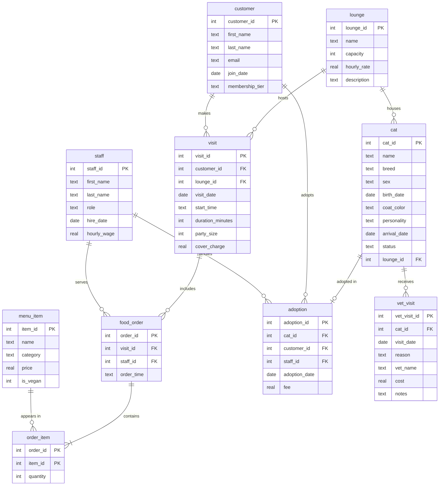

# Whisker Lounge Cat Cafe — Ask Your Database in Plain English

CS 452 AI + SQL project. **Whisker Lounge** is a (fictional) cat cafe where customers book time in themed lounges, order coffee and pastries, and can adopt the cats who live there. The database tracks the cats, lounges, customers and their visits, food orders, staff, adoptions and the cats' vet care. The app lets anyone ask questions about the cafe in plain English and get plain-English answers.

## How it works

1. You type a question, e.g. *"Which cats can I adopt?"*
2. The question and the database schema go to GPT, which writes a SQLite query.
3. The app runs that query against `cat_cafe.db` (read-only, `SELECT` only).
4. The question, query and results go back to GPT, which writes a friendly answer.

## Schema



Sample data covers January–September 2026: 22 cats, 4 lounges, 8 staff, 40 customers, 1,000 visits, ~1,000 food orders, 7 adoptions and 66 vet visits. All names and data are made up.

## Setup

Requires Python 3.10+.

```bash
pip install -r requirements.txt
copy .env.example .env        # macOS/Linux: cp .env.example .env
```

Open `.env` and paste in your OpenAI API key. **Never commit `.env`** — it's already in `.gitignore`.

`cat_cafe.db` is included. To rebuild it after changing `schema.sql` or `data.sql`, run `python setup_db.py`.

## Usage

```bash
python app.py                                   # interactive chat
python app.py -q "Who adopted Gizmo?"           # one question
python app.py --strategy zero_shot              # choose a prompting strategy
python app.py --provider anthropic              # use Claude instead of GPT (needs ANTHROPIC_API_KEY)
python run_examples.py                          # run the 10 test questions with every strategy -> results.md
```

In interactive mode, type `:strategy cross_domain` to switch strategies or `:quit` to exit. The app prints the SQL it ran, the first few rows and the answer, plus total tokens used at the end.

## Prompting strategies

Based on Chang & Fosler-Lussier, [*How to Prompt LLMs for Text-to-SQL*](https://arxiv.org/abs/2305.11853) (2023):

| Strategy | What the prompt contains |
|---|---|
| `zero_shot` | The schema (`CREATE TABLE` statements with comments) and the question. |
| `single_domain` (default) | The schema, two example question → SQL pairs from the cat cafe database, then the question. |
| `cross_domain` | A worked example from a different database (a small library), then the cat cafe schema and the question. |

`run_examples.py` scores each strategy by comparing the model's query results to a hand-written reference query for each question.

## Results

See [`results.md`](results.md) for all test questions, the SQL each strategy produced and whether it was correct.

<!-- Fill these in after running run_examples.py -->
### A question that worked

**Question:** What personality type appears the most in cats that have been adopted?        
**SQL:**
```sql
SQL (single_domain):
  SELECT personality, COUNT(*) AS cnt
  FROM cat
  WHERE status = 'adopted' AND personality IS NOT NULL
  GROUP BY personality
  HAVING COUNT(*) = (
    SELECT MAX(c)
    FROM (
      SELECT COUNT(*) AS c
      FROM cat
      WHERE status = 'adopted' AND personality IS NOT NULL
      GROUP BY personality
    )
  );
```
**Answer:** "There's a seven-way tie: cuddly, curious, energetic, gentle, independent, playful, and shy each appear most often — each shows up once among adopted cats."        

### A question that didn't work

**Question:** What month reports the highest adoptions and the highest customer sales?        
**SQL:** 
```sql
WITH adoptions AS (
    SELECT strftime('%Y-%m', adoption_date) AS month, COUNT(*) AS adoptions
    FROM adoption
    GROUP BY month
  ), sales AS (
    SELECT strftime('%Y-%m', v.visit_date) AS month,
           SUM(v.cover_charge + COALESCE(ord.order_revenue, 0)) AS sales
    FROM visit v
    LEFT JOIN (
      SELECT fo.visit_id, SUM(mi.price * oi.quantity) AS order_revenue
      FROM food_order fo
      JOIN order_item oi ON oi.order_id = fo.order_id
      JOIN menu_item mi ON mi.item_id = oi.item_id
      GROUP BY fo.visit_id
    ) ord ON ord.visit_id = v.visit_id
    GROUP BY month
  ), max_vals AS (
    SELECT (SELECT MAX(adoptions) FROM adoptions) AS max_adoptions,
           (SELECT MAX(sales) FROM sales) AS max_sales
  )
  SELECT a.month, a.adoptions, s.sales
  FROM adoptions a
  JOIN sales s USING(month), max_vals m
  WHERE a.adoptions = m.max_adoptions
    AND s.sales = m.max_sales;
```
**Answer:** "I couldn't find any month that reports both the highest adoptions and the highest customer sales — the result set was empty. If you want, I can check which month has the most adoptions and which month has the highest sales separately."           
**Why it failed:** GPT read the 'AND' in the question literally. Though the SQL was technically right, it didn't quite answer what the question originally meant. 

### Strategy comparison
The strategy didn't have a significant influence for gpt-5-mini. The query style and tie-breaking, however, changed:
- Zero-shot: often grabbed extra columns, broke ties using `HAVING SUM(...) = MAX(...)`
- Single-domain: copied the short style of its examples, broke ties using `HAVING SUM(...) = MAX(...)`
- Cross-domain: wrote shortest queries, copied libraries examples of using `LIMIT 1` and thus silently dropped ties


## Files

| File | Purpose |
|---|---|
| `schema.sql` | Table definitions (also sent to the model as context) |
| `data.sql` | Sample data |
| `setup_db.py` | Builds `cat_cafe.db` from the two files above |
| `cat_cafe.db` | The SQLite database |
| `app.py` | The natural-language app |
| `run_examples.py` | Runs the test questions through every strategy and writes `results.md` |
| `.env.example` | Template for your API key settings |
